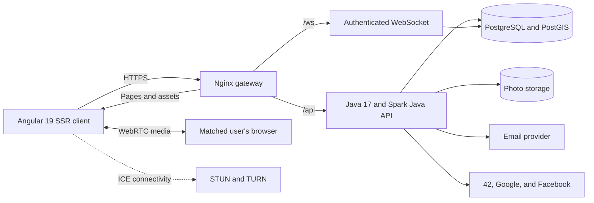

# GlanceSync

**A full-stack dating and matchmaking platform built for the 42 Matcha project.**

GlanceSync covers the complete experience from secure account creation and profile setup to intelligent discovery, mutual matching, real-time communication, and planning a date. The platform combines a responsive Angular application with a lightweight Java backend, hand-written SQL, and location-aware matching powered by PostgreSQL and PostGIS.

## Repositories

| Component | Repository | Description |
| --- | --- | --- |
| Frontend | [GlanceSync/frontend](https://github.com/GlanceSync/frontend) | Angular 19 application with server-side rendering |
| Backend | [GlanceSync/backend](https://github.com/GlanceSync/backend) | Java 17 REST API, WebSocket server, and persistence layer |

## Features

### Authentication and account security

- Registration with email verification
- Secure sign-in using short-lived JWT access tokens
- HttpOnly refresh-token cookies and server-side token revocation
- Password hashing with BCrypt
- Password recovery by email
- Password validation against common passwords and personal information
- OAuth authentication with 42, Google, and Facebook
- Single-click logout from every page

### Profiles and photos

- Gender, sexual preference, biography, birthday, and reusable interest tags
- Galleries containing up to five photos
- Profile-picture selection and automatic fallback when a photo is removed
- Drag-and-drop uploads
- Browser-based cropping, zooming, rotation, and visual filters
- JPEG, PNG, and WebP signature validation
- GPS or manually selected locations
- Control over visibility on the public map

### Discovery and search

- Two-way gender and orientation compatibility
- Recommendations based on proximity, common interests, and fame rating
- Priority for people in the same geographical area
- Swipeable discovery cards and a profile-grid view
- Advanced filtering by age, distance, city, fame rating, and interests
- Sorting by age, distance, fame rating, and shared interests
- Pagination and saved discovery preferences
- A seeded development dataset containing 500 profiles

### Matching and activity

- Likes and mutual matches
- Profile-view history
- Lists of people who liked or viewed a profile
- A fame rating calculated from views, likes, matches, and reports
- Unmatching and unlike support
- Blocking and fake-account reporting

### Real-time communication

- Real-time chat over WebSockets
- Persistent message history and read states
- Unread counters available throughout the application
- Online presence and last-seen information
- Live notifications for likes, matches, messages, profile views, events, and account activity
- Multi-tab and multi-device synchronization

### Calls and dates

- Peer-to-peer audio and video calls with WebRTC
- Authenticated WebSocket signaling for SDP and ICE messages
- STUN support and optional TURN relay credentials
- Call history for answered, missed, and declined calls
- Date proposals between matched users
- Invitation, acceptance, decline, and cancellation workflows

### Map and moderation

- Interactive OpenStreetMap interface built with Leaflet
- Marker clustering and online-only filtering
- PostGIS-backed geographical queries and distance calculations
- Privacy-conscious location approximation for displayed map markers
- Administration panel for reviewing reported accounts
- Account freezing, unfreezing, and report dismissal

## Architecture



The backend deliberately stays lightweight. It uses Spark Java's embedded Jetty server together with a custom annotation-based router and dependency container. Domain services and data-access objects remain independent of the HTTP layer, while JDBC and prepared statements provide direct control over every database query.

The authenticated WebSocket connection carries presence updates, chat messages, notifications, unread counts, and WebRTC signaling. Audio and video media travel directly between browsers rather than through the application server.

## Technology stack

### Frontend

- Angular 19
- TypeScript 5.7
- Angular Signals and reactive forms
- Angular server-side rendering
- RxJS
- Leaflet and Leaflet MarkerCluster
- WebSocket and WebRTC browser APIs

### Backend

- Java 17
- Spark Java 2.9.4 with embedded Jetty
- Jackson
- JDBC with hand-written SQL
- HikariCP connection pooling
- PostgreSQL 16 and PostGIS
- JJWT and BCrypt
- OAuth 2.0 and OpenID Connect
- Jakarta Mail
- OpenAPI and Swagger UI

### Infrastructure

- Docker and Docker Compose
- Nginx reverse proxy
- GitHub Actions
- systemd for the backend service
- PM2 for the Angular SSR service
- Automated deployment health checks and rollback

## Project structure

```text
GlanceSync/
├── backend/
│   ├── src/main/java/com/glancesync/
│   │   ├── common/          # Configuration, database, and shared infrastructure
│   │   ├── modules/         # Auth, profiles, discovery, chat, calls, events, and more
│   │   └── web/             # Custom routing and HTTP abstractions
│   ├── src/main/resources/  # Schema, configuration, and development seed data
│   └── deploy/              # Nginx, systemd, and TURN configuration
├── frontend/
│   ├── src/app/core/        # Guards, interceptors, interfaces, and services
│   ├── src/app/features/    # Application pages and feature components
│   ├── src/app/shared/      # Reusable UI components
│   └── src/server.ts        # Angular SSR server
├── docker/
│   └── nginx.conf           # Full-stack gateway configuration
└── docker-compose.yml       # Local full-stack environment
```

## Getting started

### Prerequisites

- Java 17
- Node.js 20 or later
- Docker with Docker Compose
- A Base64-encoded JWT secret of at least 32 bytes

### 1. Clone the repositories

```bash
mkdir GlanceSync
cd GlanceSync
git clone https://github.com/GlanceSync/backend.git
git clone https://github.com/GlanceSync/frontend.git
```

### 2. Configure the backend

Create `backend/.env` and provide the database credentials, JWT secret, application URL, and any optional email, OAuth, or TURN settings required by your environment.

Generate a suitable JWT secret with:

```bash
openssl rand -base64 32
```

For development, set `DB_SEED=true` to load the 500 sample profiles. Never enable development seed data in production.

### 3. Start PostgreSQL and PostGIS

```bash
cd backend
docker compose up -d
```

The development database is exposed on port `5440` by default.

### 4. Run the backend

```bash
cd backend
./mvnw compile exec:java -Dexec.mainClass=com.glancesync.Application
```

The API starts at `http://localhost:8080`.

Useful development endpoints:

- Swagger UI: `http://localhost:8080/swagger-ui.html`
- OpenAPI document: `http://localhost:8080/swagger/glancesync-0.1.json`
- WebSocket: `ws://localhost:8080/ws`

### 5. Run the frontend

```bash
cd frontend
npm ci
npm start
```

Open `http://localhost:4200` in a recent version of Chrome or Firefox.

## Docker deployment

The full environment consists of:

- PostgreSQL with PostGIS
- The Java backend
- The Angular SSR frontend
- An Nginx gateway that exposes the application from one origin

Keeping the API and WebSocket on the same public origin as the frontend is important for authenticated sessions. Production audio and video calls also require HTTPS because browsers restrict camera and microphone access on insecure origins.

## Security highlights

- Passwords are hashed with BCrypt and never stored as plain text
- Only hashes of email-verification, password-reset, and refresh tokens are persisted
- Access and refresh JWTs use separate token types and expiration periods
- Refresh tokens are sent in HttpOnly cookies
- All SQL queries use bound parameters
- Upload types are identified from file signatures rather than trusting request headers
- Blocked users are excluded from discovery, chat, calls, and notifications
- Frozen accounts are rejected on every authenticated API request
- Administrative endpoints require an administrator role
- Secrets and provider credentials are loaded from environment variables

## CI/CD

The frontend and backend repositories include GitHub Actions deployment workflows. Each workflow builds its artifact, uploads it to the target server, restarts the corresponding service, and performs a health check. If the new release fails, the previous working version is restored automatically.

## API documentation

The backend generates its OpenAPI specification directly from the registered routes and serves an embedded Swagger UI. After starting the backend, visit:

```text
http://localhost:8080/swagger-ui.html
```

## About the project

GlanceSync was created as part of the **Matcha** web project from the [42 Network](https://www.42network.org/) at [1337 Coding School](https://1337.ma/).

It explores full-stack architecture, secure authentication, geospatial data, recommendation logic, real-time systems, peer-to-peer media, responsive interfaces, containerization, and automated deployment.
